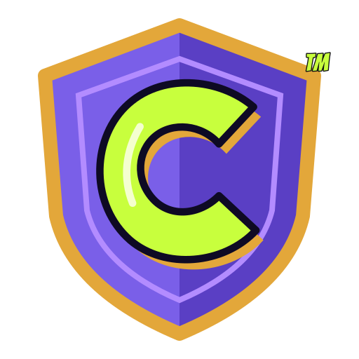
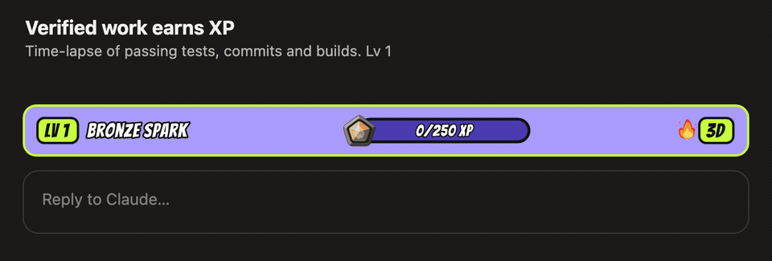
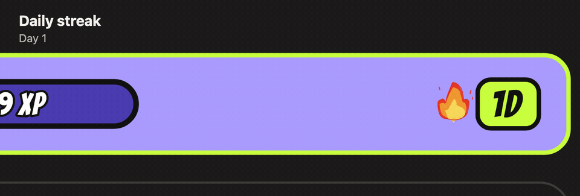
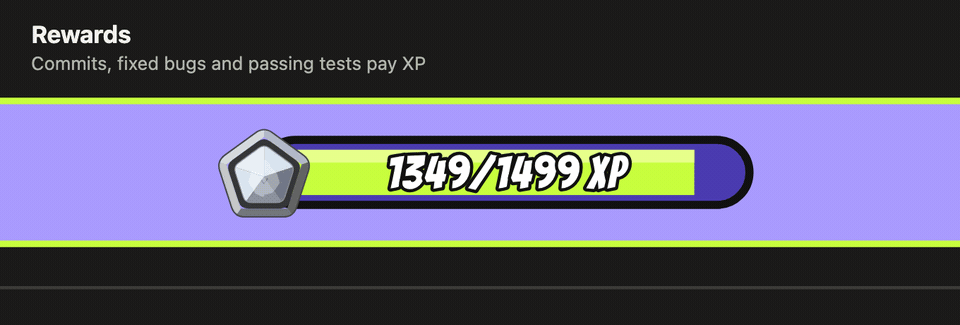
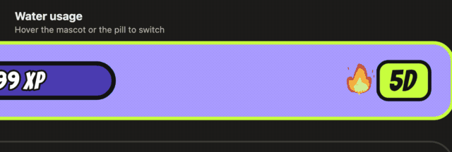
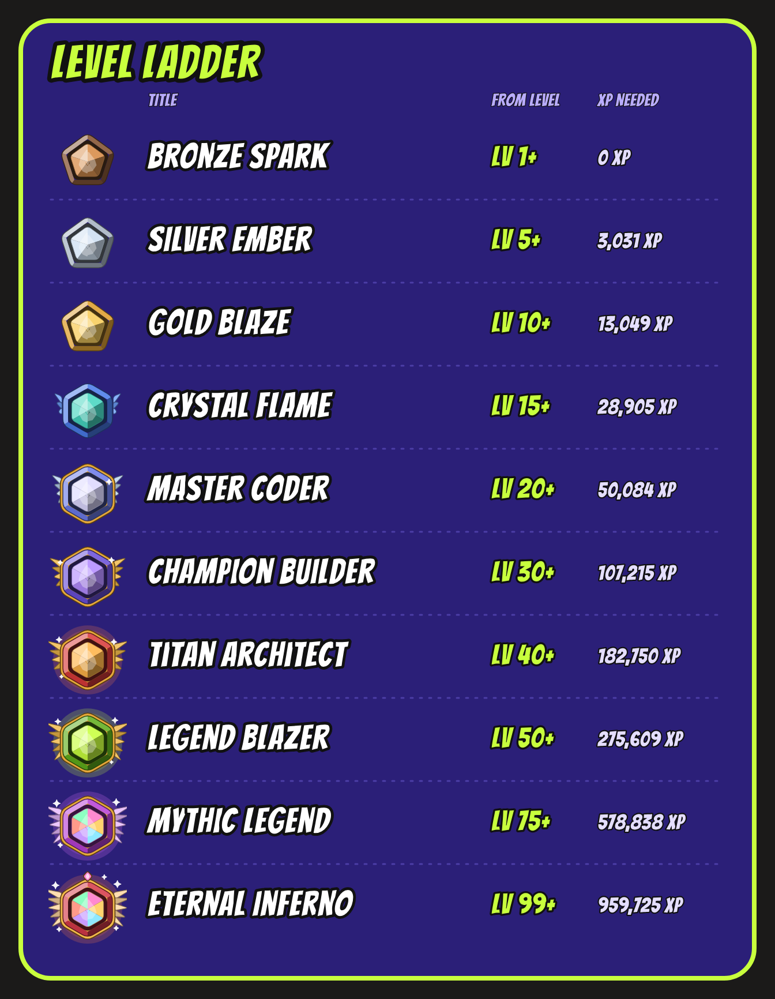

<p align="center">
  
</p>

<h1 align="center">codarc | plugin</h1>

<p align="center">
  <b>Level up for work that actually happened.</b><br>
  An RPG XP band for Claude Code. You earn XP for passing tests, commits that stick and builds that succeed, not for chatting.
</p>

<p align="center">
  <a href="LICENSE"></a>
  
  
  
</p>

<p align="center">
  
</p>

## See it in action

**Levelling up.** Passing tests, commits and builds fill the bar. Cross a level and the bar wraps; cross a tier and the title and badge change. This one is a time-lapse from level 1 to level 6.


**Daily streak.** The first turn of each day extends your streak and pays a bonus.



**Rewards.** Commits, fixed bugs and passing tests pay XP, and the first time you use a skill you get a celebration.



**Water usage.** Hover the mascot to switch from fire to water and see a rough estimate of the cooling water behind your Claude spend.



<sub>These animations are rendered from the band's own drawing code with sample numbers, not screen recordings. The toast style is illustrative, and in the level-up time-lapse the numbers count up smoothly (the live band updates in steps).</sub>

## Why

Most XP bars reward volume: tokens spent, messages sent, lines scrolled. That teaches nothing, and it is easy to farm.
codarc pays only for outcomes it can check. A passing test run, a new commit hash and a successful build earn XP, each with a daily cap. Spending money earns nothing.

## What you get

- **A level band above the prompt** (Claude desktop app) with a faceted tier badge, an XP bar with the number inside, and a streak.
- **A terminal status line** with the same level, plus HP, MP and STA meters for your context window and rate limits.
- **Ten tiers**, from Bronze Spark to Eternal Inferno, each with its own badge. Hover the title to see them all.
- **A fire or water mascot** that you can swap on hover. In water mode it shows a rough estimate of the water your Claude spend uses.
- **One save file** (`~/.claude/xp-hud/state.json`), so the desktop band and the terminal bar always show the same level.

## Quick start

```bash
claude plugin marketplace add ShravanAmudala55/codarc
claude plugin install xp-hud@shravan-plugins
claude plugin install codarc@shravan-plugins
```

Restart Claude, then send a message. The band appears above the prompt.
For the terminal bar, run `/xp-hud:setup` once. It writes the `statusLine` entry into `~/.claude/settings.json` (it never overwrites an existing one).

| Plugin | Where it works | What it does |
| --- | --- | --- |
| [`codarc`](plugins/codarc) | Claude desktop app | The band above the prompt: level, badge, XP bar, streak, mascot |
| [`xp-hud`](plugins/xp-hud) | Terminal | The status line, plus the hooks that pay XP for verified work |

Install both for the full experience. Either one also works on its own.

## How XP works

| Source | XP | Daily cap |
| --- | --- | --- |
| Tests pass | 15 | 5 |
| Tests pass after failing earlier in the session | +25 | 3 |
| New `git commit` (amends pay nothing) | 20 | 5 |
| Build or lint passes | 8 | 3 |
| Source lines you add | 0.2 per line | 60 XP |
| First work of the day | 25, plus 5 per extra streak day | once a day |
| First use of a skill | 30 | once per skill |

Level `L` needs `round(250 × (L − 1)^1.8)` XP, up to level 99.

**Built to resist farming:** every source has a daily cap, commit hashes are de-duplicated, amends pay nothing, and a session that does nothing earns nothing. All the numbers sit at the top of [`xp.py`](plugins/xp-hud/scripts/xp.py) if you want levelling faster or slower.

## Tiers

Ten tiers, each with its own badge. The badge and title change as you level up, and hovering the title in the band shows this same list.

<p align="center">
  
</p>

## Privacy

Everything stays on your machine. There are no network calls, and codarc never reads your prompts or transcripts.
After a Bash, Edit or Write call, a hook looks at the command, the file path and whether it succeeded, only to recognise tests, commits, builds and source edits. None of that text is stored. The save file keeps counters and short commit hashes.

## Requirements

- Claude Code with plugin support. The band needs the Claude desktop app.
- Python 3 on your `PATH` for the terminal plugin.
- On Windows, edit the `python3` command in `plugins/xp-hud/hooks/hooks.json` and the two skills to `python`. File locking is not implemented there yet.

## Uninstall

```bash
python3 ~/.claude/xp-hud/xp.py uninstall
claude plugin uninstall xp-hud@shravan-plugins
claude plugin uninstall codarc@shravan-plugins
```

Your save file is kept, so you can come back to your level later.

## Development

```bash
python3 -m unittest discover -s tests -v
claude plugin validate .
```

Try changes without installing: `claude --plugin-dir ./plugins/xp-hud`.
Issues and ideas are welcome.

## Credits and licence

MIT, see [LICENSE](LICENSE). Comic lettering uses glyph outlines from [Bangers](https://github.com/googlefonts/bangers) (SIL OFL 1.1), see [NOTICE](plugins/codarc/NOTICE.md). The water figure is an estimate, not an Anthropic number.
