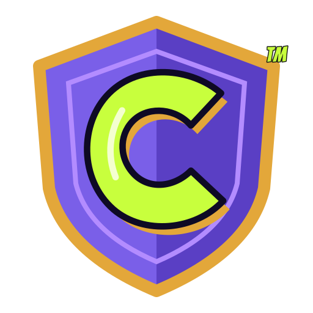

<p align="center"></p>

# codarc

A band above the prompt in the Claude desktop app that shows your RPG progress: level, tier badge, XP bar with the number inside it, and a streak. It reads and writes `~/.claude/xp-hud/state.json`, the same save file the terminal [xp-hud](https://github.com/ShravanAmudala55/codarc/tree/main/plugins/xp-hud) status line uses, so both show the same level.

## What it does
- **Tier badge and title:** ten tiers from Bronze Spark to Eternal Inferno. Hover the title to see every tier.
- **Streak and daily bonus:** the first turn of each day extends the streak and pays a bonus.
- **Verified XP:** tests that pass, a failing test you then fix, new commits, builds and lint that pass, and source lines you add earn XP, each with a daily cap. Spending pays nothing.
- **First use of a skill:** +30 XP once per skill, with a celebration banner.
- **Fire or water mascot:** hover the mascot or the pill on the right to switch. In water mode the pill shows a rough estimate of the water your Claude spend uses (about 80 mL per dollar; a rough figure, not an Anthropic number).

## XP rules
| Action | XP | Daily cap |
|---|---|---|
| Tests pass | 15 | 5 |
| Tests pass after failing | +25 | 3 |
| New `git commit` | 20 | 5 |
| Build or lint passes | 8 | 3 |
| Source lines added | 0.2 each | 60 XP |

Level L needs `round(250 * (L - 1) ^ 1.8)` XP, up to level 99.

## Install

```bash
claude plugin marketplace add ShravanAmudala55/codarc
claude plugin install codarc@shravan-plugins
```

Or inside Claude Code: `/plugin install codarc --marketplace ShravanAmudala55/codarc`. Install `xp-hud` from the same marketplace to pay XP for verified work in the terminal too.

## Licence
MIT, see `LICENSE`. The lettering uses glyph outlines from Bangers (SIL OFL 1.1), see `NOTICE.md` and `OFL-Bangers.txt`.
